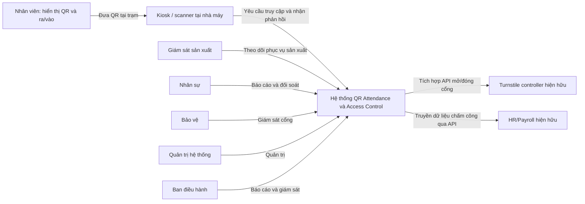
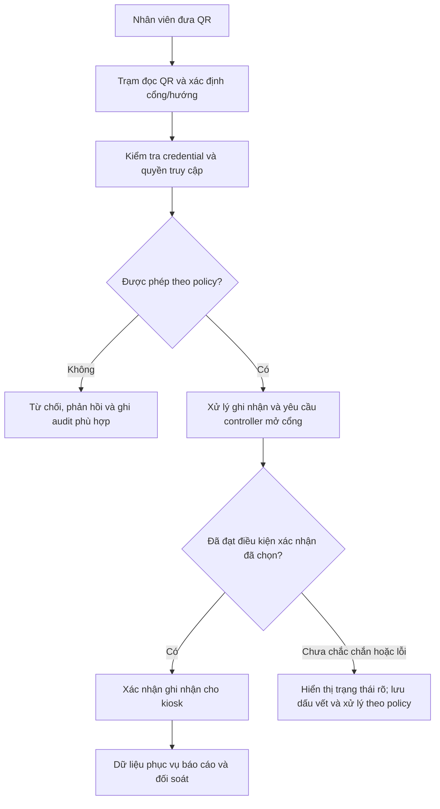
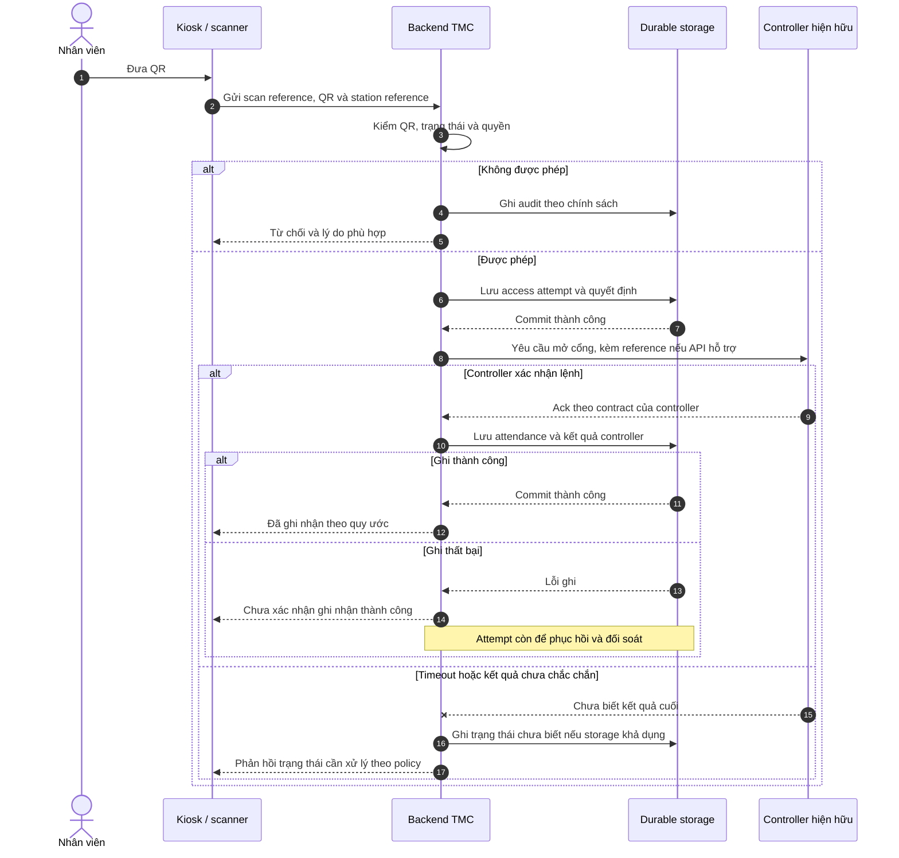
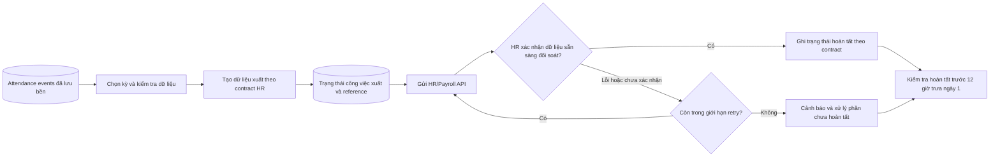
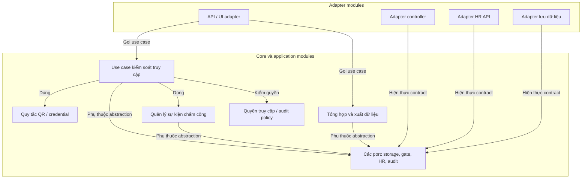
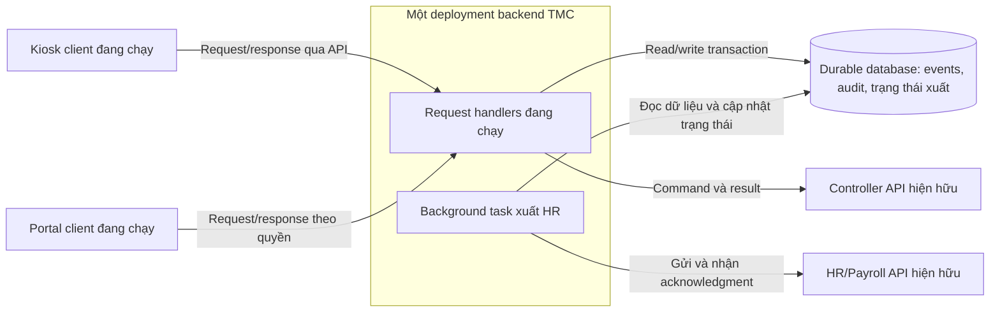
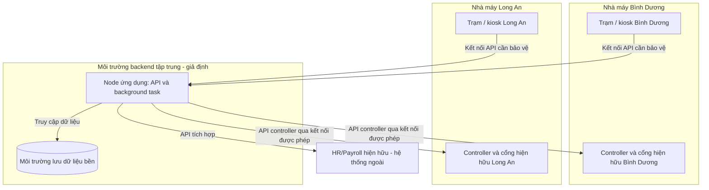
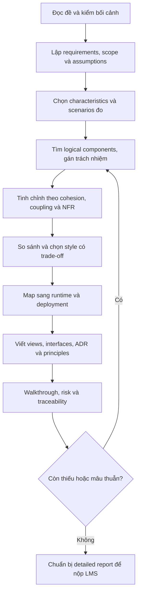

# Hiểu Assignment M1 qua câu chuyện và sơ đồ

> Đọc bản này để nắm bài trước, rồi dùng [summary.md](../overview/summary.md) để kiểm đủ yêu cầu. Dữ kiện đề có dẫn nguồn; mọi module, topology, trạng thái và policy chi tiết trong hình là **ĐỀ XUẤT MINH HỌA**, chưa phải quyết định được TMC/giảng viên chấp thuận.

## Mục lục

1. [Bạn đang được giao làm gì?](#1-bạn-đang-được-giao-làm-gì)
2. [Nhìn toàn cảnh hệ thống](#2-nhìn-toàn-cảnh-hệ-thống)
3. [Một lượt quét QR có gì bên trong?](#3-một-lượt-quét-qr-có-gì-bên-trong)
4. [Từ sự kiện hằng ngày đến đối soát tháng](#4-từ-sự-kiện-hằng-ngày-đến-đối-soát-tháng)
5. [Ba góc nhìn của cùng một thiết kế](#5-ba-góc-nhìn-của-cùng-một-thiết-kế)
6. [Bốn phần kiến trúc phải giải thích](#6-bốn-phần-kiến-trúc-phải-giải-thích)
7. [Lộ trình làm và những lỗi dễ mắc](#7-lộ-trình-làm-và-những-lỗi-dễ-mắc)

## 1. Bạn đang được giao làm gì?

TMC có nhà máy Bình Dương khoảng 800 nhân viên và Long An khoảng 600. Công ty muốn nhân viên dùng QR để ra/vào cổng, ghi nhận chấm công và chuyển dữ liệu sang hệ thống HR/Payroll đã tồn tại. Đến trước 12 giờ trưa ngày đầu tháng, dữ liệu phải có để đối soát. Controller cổng cũng đã có API để tích hợp. Đây là dữ kiện [đề M1 PDF tr.1](../../SA_CC_hk261_Assignment_M1.pdf).

**M1 yêu cầu bạn giải thích và thiết kế cách hệ thống được tổ chức để đáp ứng bài toán.** Bạn phải nói được tại sao chọn cấu trúc đó, các phần làm gì, giao tiếp ra sao, chạy ở đâu và đạt tiêu chí nào. M2 mới là mốc hoàn thiện thiết kế, lập trình và kiểm thử theo đặc tả bổ sung sau này.

Ví dụ, câu “dùng Java, React và PostgreSQL” chỉ nêu công nghệ. Câu trả lời kiến trúc còn phải cho biết ai xác thực QR, ai quyết định mở cổng, sự kiện được lưu lúc nào, HR nhận dữ liệu bằng cách nào và lỗi ở một phần ảnh hưởng các phần khác thế nào.

### Những điều bắt buộc phải nhớ

| Đề nêu | Ý nghĩa thực tế |
|---|---|
| Kiosk phản hồi ≤ 2 giây | Một lượt xử lý không được khiến người đứng chờ quá ngưỡng trong điều kiện tải quy định; cần chốt ranh giới đo |
| Khoảng 800 giao dịch/30 phút/nhà máy | Tải đổi ca để thiết kế/đánh giá; không phải 800 người đồng thời |
| Không mất bản ghi trong vận hành bình thường | Cần giải thích việc ghi dữ liệu bền và cách xác nhận |
| RBAC và audit toàn diện | Mỗi vai trò có quyền phù hợp, các hành động cần truy vết được ghi lại |
| Bảo vệ dữ liệu cá nhân | Không để ai cũng đọc hoặc xuất toàn bộ dữ liệu nhân viên |
| HR có dữ liệu trước trưa ngày 1 | Phải hoàn tất bước cần thiết để dữ liệu sẵn sàng đối soát; không chỉ bắt đầu gửi ở giờ đó |

Nguồn bảng: đề PDF tr.1–2. Mức tải trung bình suy ra là 800/1.800 ≈ 0,444 giao dịch/giây/nhà máy. **Trung bình thấp không bảo đảm không có đợt dồn quét trong vài giây.** Không dùng con số đó làm benchmark đã đạt hoặc lý do bỏ qua sizing.

## 2. Nhìn toàn cảnh hệ thống

Sơ đồ dưới là **system context**: ranh giới lớn, người dùng và các hệ thống liên quan. Đường nối biểu thị tương tác/nghiệp vụ, chưa xác định protocol hoặc nơi deploy. Danh sách actor và các tích hợp lấy từ đề tr.1; tác vụ chi tiết theo role là diễn giải để hiểu bài.

Hệ thống cần xây là phần xử lý kiểm soát ra/vào/chấm công. HR/Payroll và controller là bên tích hợp hiện hữu. Kiosk/scanner là một phần của bối cảnh thiết bị; ứng dụng mới trên đó và khả năng cụ thể cần được xác định. Quản lý khách và tính lương không nằm trong phạm vi đã cho.

## 3. Một lượt quét QR có gì bên trong?

Hãy hình dung một nhân viên tới cổng Bình Dương lúc đổi ca. Người đó mở QR trên smartphone, đưa trước scanner. Bên dưới hành động đơn giản này có nhiều câu hỏi:

1. QR thuộc về ai và còn dùng được không?
2. Nhân viên có quyền vào/ra tại cổng này không?
3. Hệ thống ghi điều gì, vào thời điểm nào?
4. Controller có chấp nhận lệnh không, và có bằng chứng người đã đi qua không?
5. Kiosk được phép thông báo thành công khi nào?

QR được đọc thành công chỉ cho biết scanner đọc được dữ liệu. QR hợp lệ không tự chứng minh người cầm QR là chủ QR. Controller nhận lệnh cũng không tự chứng minh nhân viên đã qua cổng. Các cách chống chia sẻ QR hoặc cảm biến xác nhận passage là **điểm cần xác nhận**, không có sẵn trong đề.

### 3.1. Luồng nghiệp vụ khái quát

Hình này minh họa các trách nhiệm cần phân tích. “Ghi nhận và điều khiển” được tách chi tiết trong sequence tiếp theo; thứ tự và điều kiện commit là quyết định phải giải thích.

### 3.2. Một phương án sequence để học cách đọc thiết kế

**Các giả định riêng cho ví dụ**, không phải requirement gốc:

- **ASM-EX-01:** có backend tập trung xử lý lượt quét online; trạm được định danh và biết hướng vào/ra.
- **ASM-EX-02:** không có sensor passage được đặc tả. Quy ước minh họa ghi attendance sau quyết định cho phép và controller ack; đây là dấu vết được ghi nhận theo quy ước, không chứng minh passage vật lý. Quy ước này phải được xác nhận nếu dùng trong bài làm.
- **ASM-EX-03:** trước khi gửi lệnh có access attempt đã ghi bền để giữ dấu vết và hỗ trợ đối soát. Command reference là định danh thiết kế nội bộ; khả năng controller hiểu hoặc chống lặp theo reference chưa được đề cung cấp.
- Nếu lần lưu đầu tiên thất bại, phương án này chưa gửi lệnh mở; nếu controller đã ack nhưng ghi attendance lỗi thì không báo đã ghi nhận thành công. Cần mô tả phục hồi từ attempt/đối soát controller và giới hạn bằng chứng.

Điều cần học từ hình: có **nhiều lần xác nhận khác nhau**, và một transaction database không kéo được cổng vật lý vào cùng rollback. Tăng độ bền có thể thêm I/O/latency; backend–controller có thêm network call. Phương án này phải được đo và đánh giá với NFR-01, chưa có bằng chứng đã đạt 2 giây. Nhánh audit lỗi và các failure mode mở rộng cần được phân tích thêm nếu dùng làm thiết kế cuối.

Nếu chọn phương án khác như ghi attendance trước lệnh mở hoặc dùng edge component, phải giải thích ý nghĩa sự kiện, trạng thái cổng thất bại và nguồn dữ liệu đối soát. Không có một thứ tự duy nhất tự động đúng trong mọi contract.

## 4. Từ sự kiện hằng ngày đến đối soát tháng

Đề yêu cầu ghi các lượt vào/ra và hỗ trợ báo cáo tháng. **Một lượt quét không phải một dòng lương.** HR/Payroll chịu trách nhiệm tính lương; hệ thống TMC xuất dữ liệu chấm công theo contract.

Ví dụ một nhân viên vào buổi sáng, ra cuối ca: hệ thống có hai sự kiện với thời gian, trạm/cổng, hướng và tham chiếu nhân viên. Khi tổng hợp, cần biết cách xử lý ca qua đêm, quét lặp, thiếu lượt ra và điều chỉnh. Đề chưa định nghĩa các quy tắc đó, nên không tự kết luận cứ lấy “giờ ra − giờ vào” là đủ cho mọi trường hợp.

Hình dưới là **đề xuất luồng xuất**, với giả định dữ liệu kỳ tháng cần xuất đã được xác định cùng HR. Kỳ “tháng trước” và múi giờ Việt Nam là giả định hợp lý để phân tích, vẫn cần xác nhận. Worker/job ở đây là trách nhiệm xử lý nền, không nhất thiết một service độc lập.

Đừng đọc đường nối từ Alert đến Deadline như “có cảnh báo là đạt deadline”. Nó có nghĩa vẫn phải đánh giá dữ liệu đã sẵn sàng hay còn gap cần xử lý. Retry phải có giới hạn, trạng thái và cách chống xuất trùng. Nếu API chỉ trả “đã nhận yêu cầu”, cần xem acknowledgment nào đủ chứng minh readiness theo thỏa thuận.

Một thiết kế có thể xuất tăng dần trong tháng và đối soát/chốt kỳ sau đó; một thiết kế khác có thể dùng batch. Đề chưa bắt buộc cách nào. Dù cách nào, nên có thời gian dự phòng và giám sát phần chưa hoàn tất; không đợi đúng 12 giờ mới bắt đầu gửi.

## 5. Ba góc nhìn của cùng một thiết kế

Theo [Chapter 6](../../Slides/Chapter6_SA_CC_2025.pdf), cần phân biệt cách tổ chức code, cách hệ thống tương tác lúc chạy và cách phần mềm gắn với môi trường. Các hình tiếp theo dùng **một phương án modular monolith có tác vụ nền** để minh họa cách mapping. Đây là ứng viên học tập, chưa thay cho phần so sánh style trong báo cáo M1.

### 5.1. Module view — trách nhiệm và phụ thuộc code

Các hộp là module/nhóm code. Mũi tên nghĩa là **phụ thuộc code**; không phải thứ tự runtime hoặc đường truyền dữ liệu. Các adapter phụ thuộc abstraction trong core, minh họa DIP.

Đây là sơ đồ ranh giới trách nhiệm giản lược, không liệt kê mọi module quản trị/trạm hay interface cụ thể. Nếu dùng trong báo cáo, phải mở rộng catalog để bao phủ FR-01…05, chỉ rõ owner của quản lý trạm và administration. Không coi “Ports” là một interface khổng lồ: các contract cần được tách theo client/trách nhiệm để giữ ISP.

### 5.2. C&C view — các phần đang chạy tương tác thế nào?

Các hộp runtime có process/client hoặc tác vụ có hành vi thực thi. Mũi tên có label chỉ loại tương tác. Trong ví dụ này request handler và background task thuộc **cùng deployment backend**; module ở hình trước không tự biến thành service riêng.

Phương án dùng tác vụ nền đọc trạng thái bền không buộc có message broker. Nếu chọn EDA/broker, phải thêm nó vào C&C, chỉ ra producer/consumer, durability/ack, duplicate handling và update mapping. “Có background task” chưa đủ gọi toàn hệ thống là event-driven architecture.

### 5.3. Allocation/deployment view — chạy ở đâu?

Các vùng là nơi triển khai/môi trường. Các hộp bên trong là ứng dụng/thiết bị được phân bổ. Đường nối mô tả kết nối logic; chưa là thiết kế firewall/VPN chi tiết. Backend tập trung, số node và cách lưu trữ là **giả định của ví dụ**, không phải hạ tầng TMC được đề cung cấp.

Sơ đồ cho thấy phụ thuộc mạng giữa nhà máy và backend. Một node trung tâm là cách vẽ đơn giản để học, chưa chứng minh khả dụng/sizing; nếu chọn cho bài cuối cần đánh giá điểm lỗi chung, latency tới controller và cách xử lý mất kết nối. Đề chưa yêu cầu cụ thể số server, HA topology hoặc cloud provider.

### 5.4. Đối chiếu các view

| Trách nhiệm logic | Runtime trong ví dụ | Nơi chạy trong ví dụ | Vì sao cần liên hệ? |
|---|---|---|---|
| QR, access, attendance, permission | Request handlers và các object/module được gọi | Node ứng dụng trung tâm | Phân tích đường quét và ngân sách 2 giây |
| Adapter controller | Code gọi controller từ backend | Node ứng dụng; kết nối đến controller nhà máy | Tách source dependency khỏi network dependency |
| Tổng hợp/xuất HR và HR adapter | Background task | Cùng deployment backend | Không cần bắt lượt quét đợi công việc xuất dài |
| Storage/audit persistence | Backend adapter và database runtime | App node + môi trường storage | Xác định transaction/durability boundary |

Một module có thể tạo nhiều object lúc chạy; một deployment có thể chứa nhiều module. Một database nằm trên node riêng không tự làm backend thành microservices. Đây là lý do cần ba view và bảng mapping cùng tên rõ ràng.

## 6. Bốn phần kiến trúc phải giải thích

Task 1 trong [đề tr.2–3](../../SA_CC_hk261_Assignment_M1.pdf) yêu cầu characteristics, structure, architecture decisions và design principles.

| Phần | Nói bằng ngôn ngữ dễ hiểu | Một ví dụ để lập luận |
|---|---|---|
| Characteristics | Hệ thống phải tốt ở điểm nào, đo thế nào? | Kiosk ≤ 2 giây theo workload đề; sự kiện được ghi không mất trong điều kiện đã định |
| Structure | Chia trách nhiệm, đóng gói chạy và phân bổ ra sao? | So sánh modular monolith với service-based rồi map module sang backend/worker |
| Decisions | Nhóm đã chọn quy tắc xây dựng nào, tại sao? | Đề xuất không gọi HR đồng bộ trong lượt quét; phân tích ưu/nhược và ngoại lệ |
| Principles | Nguyên tắc nào dẫn đường cho thiết kế chi tiết? | Core phụ thuộc abstraction; adapter cô lập API vendor; interface theo nhu cầu client |

### Vì sao phải so sánh style?

Bạn cần cho thấy đã chọn theo vấn đề, không chọn vì tên công nghệ nghe hiện đại. Ví dụ so sánh cùng các tiêu chí: latency lượt quét, lưu bền, thay đổi nghiệp vụ, integration, bảo mật, vận hành và chi phí.

- Modular monolith giảm remote calls nội bộ và dễ kiểm soát transaction hơn, nhưng các module deploy/scale cùng nhau và chia sẻ failure boundary.
- Service-based tách một số dịch vụ miền, linh hoạt deploy hơn, nhưng tăng lỗi mạng và data/schema coordination.
- Microservices có thể phù hợp khi cần độc lập theo miền và có đội vận hành đủ năng lực; chi phí versioning/observability/workflow phân tán lớn hơn.
- EDA hữu ích cho phần phản ứng/báo cáo/xuất dữ liệu, nhưng phải xử lý độ trễ, ordering, gửi lặp và theo dõi hoàn tất.

Đây là các khuynh hướng từ S5/B, không phải kết quả benchmark. Mức tải đã cho chưa đủ để khẳng định một style chắc chắn đạt hoặc thất bại.

### SOLID xuất hiện ở đâu?

| Nguyên tắc | Nhìn vào ví dụ để hiểu |
|---|---|
| SRP | Logic quyền/QR không trộn toàn bộ với báo cáo tháng và SDK cổng |
| OCP | Thêm hãng controller qua adapter phù hợp, giảm sửa core |
| LSP | Mọi controller adapter có cùng ý nghĩa ack/rejected/unknown theo contract |
| ISP | Scanner/use case không buộc phụ thuộc interface có cả chức năng HR không dùng |
| DIP | Gate adapter phụ thuộc port của core, thay vì core phụ thuộc SDK vendor |

Đừng viết năm định nghĩa rồi dừng. Bài làm phải chỉ vào ranh giới/interface/dependency thật của thiết kế và giải thích một thay đổi cụ thể.

## 7. Lộ trình làm và những lỗi dễ mắc

### 7.1. Làm theo chuỗi nào?

Thiết kế là vòng lặp: có thể cần quay lại requirements khi phát hiện một câu hỏi nghiệp vụ làm thay ranh giới. Hình biểu diễn luồng công việc chính, không cấm trao đổi giữa các bước.

### 7.2. Mỗi phần phải để lại chứng cứ gì?

| Công việc | Chứng cứ người đọc cần thấy | Tra ở đâu? |
|---|---|---|
| Hiểu đề | Bối cảnh, actor, scope, FR/NFR và điều chưa rõ | summary mục 2–5,8 |
| Đặt tiêu chí thành công | Driver và quality scenarios | knowledge mục 5 |
| Tạo cấu trúc | Các bước phân rã, catalog, dependency, logical mapping | skill bước 3–5 |
| Chọn kiến trúc | Alternatives và rationale theo cùng tiêu chí | knowledge mục 6 |
| Mô tả nhiều view | Module, C&C, Allocation, catalogue và interface | knowledge mục 8 |
| Ghi lý do và nguyên tắc | ADR, hệ quả, SOLID cụ thể | skill bước 6 |
| Kiểm bài | Requirement-to-design traceability, risk và walkthrough | summary mục 7,9; rules |

### 7.3. Lỗi dễ làm mất tính thuyết phục

- Chỉ vẽ deployment/cloud mà không nói nghiệp vụ nằm trong module nào.
- Chọn microservices vì “1.400 nhân viên là lớn” mà không phân tích workload hoặc chi phí.
- Đổi ≤ 2 giây thành average/p95, rồi tưởng đã giữ nguyên yêu cầu.
- Gọi mọi lần quét là người đã qua cổng, hoặc bỏ qua timeout sau khi controller đã mở.
- Nói có queue nên chắc chắn không mất/trùng dữ liệu mà không nêu điểm lưu bền và ack.
- Viết phần tính lương/quản lý khách, nhưng quên RBAC, audit hoặc đối soát tháng.
- Ghi QR động, nhận diện khuôn mặt, offline mode hoặc HA như requirement đã có trong đề.
- Gọi diagram minh họa là UML chuẩn, hoặc ba view dùng ba bộ tên không mapping được.
- Bịa “đã test đạt 2 giây” khi mới thiết kế và chưa có ứng dụng để chạy.

Bạn có thể tự kiểm khả năng hiểu bài bằng năm câu: **ai dùng, hệ thống làm gì, phải đạt điều gì, tại sao cấu trúc đó phù hợp, và dựa vào đâu để kiểm chứng?** Nếu trả lời được bằng requirement IDs, view và ADR cụ thể, bạn đã có nền tảng để viết báo cáo M1.
